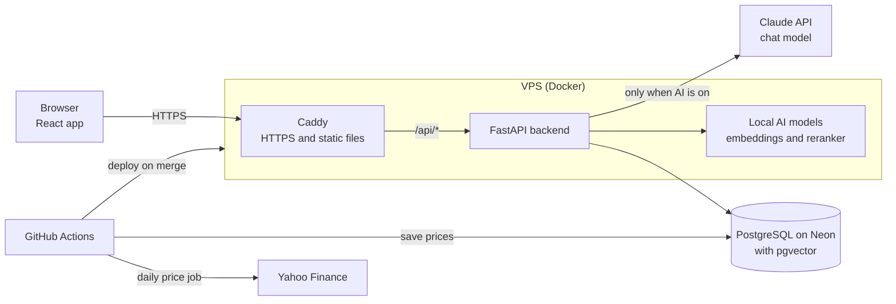
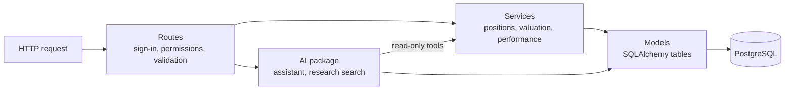
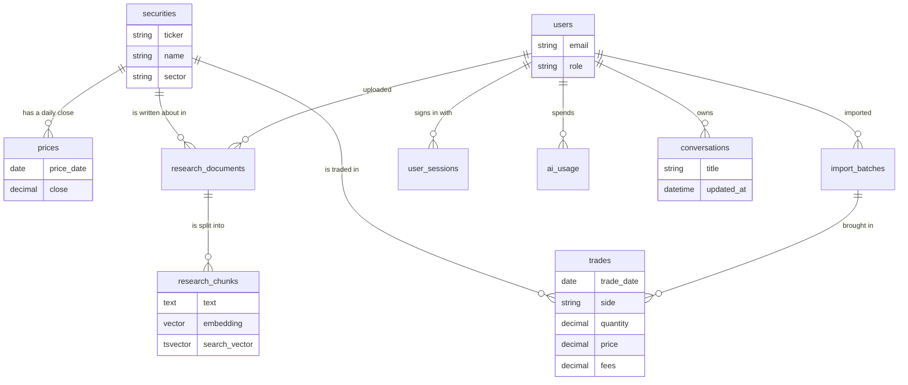
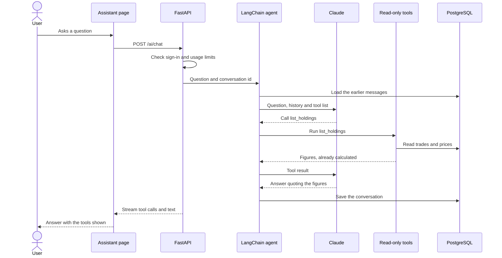
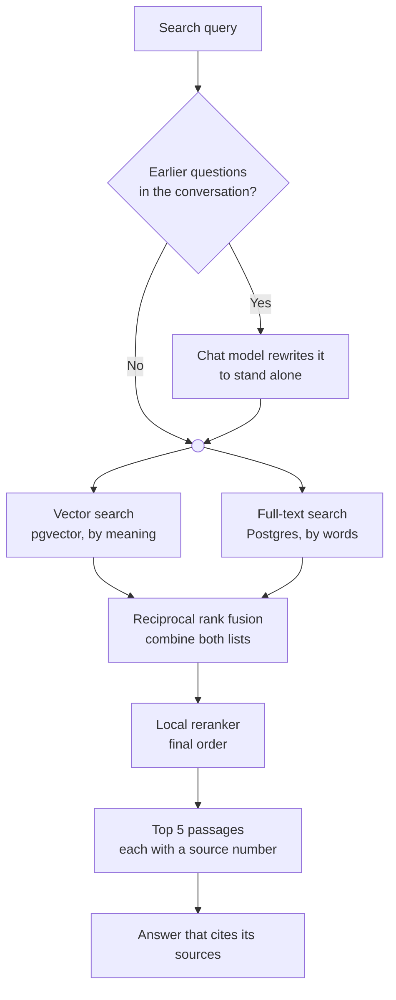

# portfolio-analytics-platform

**Live site:** https://portfolio-analytics.daniel-liu.dev

A full-stack web app for tracking a fund's holdings, performance and research, with an AI assistant that answers questions about the portfolio. It is modelled on the internal tools portfolio managers and analysts use at an investment fund.

> **Personal project.** Built around a fictional fund. It contains no real client data and is not affiliated with any investment firm.

## Features

- **Trades.** Import trades from a CSV file, then filter, sort and export them. An import is all or nothing, and the same file cannot be imported twice.
- **Holdings.** Positions are calculated from the trades, now or as at any past date. Each security has its own page with its position, price chart and trades.
- **Dashboard.** Market value, realised and unrealised profit, sector allocation, the portfolio's value over time, and its return against a benchmark.
- **Login and roles.** Every page needs a sign in, and each role can do different things.
- **AI assistant.** Ask questions about the portfolio in plain English. Answers stream in, show which tools were used, and conversations are saved.
- **Research.** Upload research notes as PDF, Markdown or text. The assistant searches them and cites the passages it uses.

## Tech stack

| Layer    | Technology |
| -------- | ---------- |
| Frontend | React, TypeScript, Vite, Tailwind CSS, ECharts, Vitest |
| Backend  | Python, FastAPI, SQLAlchemy, Alembic, pytest |
| AI       | LangChain, LangGraph, pgvector, FastEmbed, Claude |
| Database | PostgreSQL on Neon |
| Hosting  | Docker, Caddy, GitHub Actions |

## System design

### Architecture

The browser only ever talks to Caddy. Caddy serves the React app and passes API calls to the backend, which is the only part that touches the database or the AI model.



### Inside the backend

A request moves in one direction. Routes handle HTTP, services hold the business rules, and models describe the tables, so each layer can be changed and tested separately.



### Data model

Positions are never stored. They are calculated from `trades`, which is why there is no holdings table.



### How the assistant answers a question

The model decides which tools to call, but it never does the maths. Every figure in an answer comes back from a tool that runs the same code as the pages.



### How research is searched

Two searches run side by side so that a question is matched both by what it means and by the exact words it uses.



## Key decisions

**Positions come from trades.** There is no holdings table. A position is worked out by adding up its trades, using the weighted average cost method, so the trade ledger is the single source of truth and a position can be shown as at any past date. Money and quantities use exact decimals, never floats.

**Prices are stored, not fetched live.** A job saves each security's closing price from Yahoo Finance on weekdays. The pages only read stored prices, so they keep working if Yahoo is unavailable.

**Returns are time-weighted.** Each day's gain is measured on the value held at the start of that day, so money going in or out does not count as a gain or a loss. The benchmark is VAS, an ETF that follows the ASX 300.

**Each role has its own permissions.**

| Role              | View everything | Export trades | Import trades | Upload research |
| ----------------- | --------------- | ------------- | ------------- | --------------- |
| Operations        | Yes             | Yes           | Yes           | Yes             |
| Portfolio Manager | Yes             | Yes           | No            | No              |
| Analyst           | Yes             | No            | No            | Yes             |

## AI features

The AI features are off unless `AI_ENABLED` is `true`. While off, the AI pages are hidden and the app runs without any API key.

- **The model never calculates a figure.** The assistant is a LangChain agent whose tools wrap the same services the pages use. Every tool only reads, and the model quotes figures exactly as a tool returned them.
- **Research is searched three ways.** A vector search (pgvector) and a Postgres full-text search run side by side, their results are combined, and a small local model reranks them. Follow-up questions are rewritten to stand alone before they are searched.
- **Answers cite their sources.** The list of sources is built from what the search found, not from what the model wrote. Text inside a document is treated as a quote, never as an instruction.
- **Conversations are remembered.** They are stored in PostgreSQL with LangGraph's checkpointer, and each one belongs to the user who started it.
- **Usage is capped.** Each user gets 20 requests an hour and 200,000 tokens a day by default.
- **Embeddings and reranking run locally,** so only the chat model needs an API key.

### Measuring search quality

A set of 41 golden questions about the sample research notes scores each step of the search. Results are hit rate and MRR (1.000 means the right passage is always ranked first):

| Search                      | Questions (25) | Keywords (10) | Follow-ups (6) |
| --------------------------- | -------------- | ------------- | -------------- |
| Meaning only                | 100%, 0.900    | 90%, 0.542    | 100%, 0.867    |
| Meaning and words           | 100%, 0.860    | 100%, 0.925   | 100%, 1.000    |
| Meaning and words, reranked | 100%, 0.933    | 100%, 1.000   | 100%, 0.917    |

The library is only ten chunks, so treat these as a guide.

```bash
python -m scripts.run_evals              # search only: free
python -m scripts.run_evals --answers    # also judges the assistant's answers: spends API credit
```

## Project structure

```
portfolio-analytics-platform/
├── backend/
│   ├── app/
│   │   ├── ai/           The assistant, its tools, research search and evals
│   │   ├── models/       Database tables
│   │   ├── routes/       HTTP endpoints
│   │   ├── schemas/      Shapes of the JSON the API returns
│   │   └── services/     Business logic such as positions and valuation
│   ├── alembic/          Database migrations
│   ├── jobs/             Price jobs that run outside the API
│   ├── sample_data/      Example trades, prices, research notes and eval questions
│   ├── scripts/          Seed scripts and the eval script
│   └── tests/            pytest tests, with real PostgreSQL tests in integration/
├── frontend/
│   └── src/
│       ├── api/          Typed calls to the backend
│       ├── components/   Shared components
│       ├── hooks/        Shared hooks
│       ├── lib/          Helpers such as formatting
│       └── pages/        One component per screen
└── .github/workflows/    CI, deploy and the daily price refresh
```

## Local setup

You need Python 3.12+, Node.js 24+ and Docker.

**1. Start the database** from the project folder. It listens on port 5433.

```bash
docker compose -f docker-compose.dev.yml up -d
```

**2. Start the backend.** It runs at http://localhost:8000, with interactive API docs at http://localhost:8000/docs.

```bash
cd backend
python3 -m venv .venv
source .venv/bin/activate
pip install -r requirements-dev.txt
cp .env.example .env
alembic upgrade head
uvicorn app.main:app --reload
```

**3. Load the starting data.** Add a password of at least 12 characters for each demo account to `backend/.env` first, as `DEMO_PASSWORD_OPERATIONS`, `DEMO_PASSWORD_PORTFOLIO_MANAGER` and `DEMO_PASSWORD_ANALYST`.

```bash
python -m scripts.seed            # 10 ASX securities
python -m jobs.seed_prices        # a year of closing prices
python -m scripts.seed_users      # one demo account per role
python -m scripts.seed_research   # five sample research notes, for the AI features
```

The demo accounts are `operations@example.com`, `pm@example.com` and `analyst@example.com`. Sample trades to import are in `backend/sample_data/trades_sample.csv`.

**4. Start the frontend** in a second terminal. It runs at http://localhost:5173.

```bash
cd frontend
npm install
cp .env.example .env
npm run dev
```

**To use the AI features,** add `AI_ENABLED=true` and `ANTHROPIC_API_KEY` to `backend/.env`. Every other setting is optional and listed in `backend/.env.example` with its default.

## Tests and linting

```bash
# backend, from backend/
pytest
ruff check .
ruff format .

# frontend, from frontend/
npm test
npm run lint
npm run format
```

No test calls a real AI model: the tests use fake ones. The tests in `tests/integration/` run against the local PostgreSQL and are skipped when `TEST_DATABASE_URL` is not set.

## Deployment

The site runs on a VPS as two Docker containers: Caddy, which serves the React app over HTTPS and passes `/api/*` on, and the FastAPI backend. The database stays on Neon.

1. A pull request runs CI: lint, format check, tests, type check and a build of both Docker images.
2. When it is merged, the Deploy workflow publishes the images, connects to the server over SSH, runs the migrations and restarts the containers.
3. It finishes by checking the site's health endpoint, and fails if the site does not come up healthy.

The server's settings are listed in `.env.prod.example`. Closing prices are refreshed by a scheduled workflow on weekdays.

## Known limitations

- Prices are daily closing prices for ASX tickers only, and dividends are not counted.
- Currencies are not converted. The Dashboard shows a warning if positions use more than one.
- A sell is not checked against what is held when imported. The position is reported as oversold instead.
- There is no sign-up or password reset. Accounts are created by the seed script.

## License

Released under the [MIT License](LICENSE).
